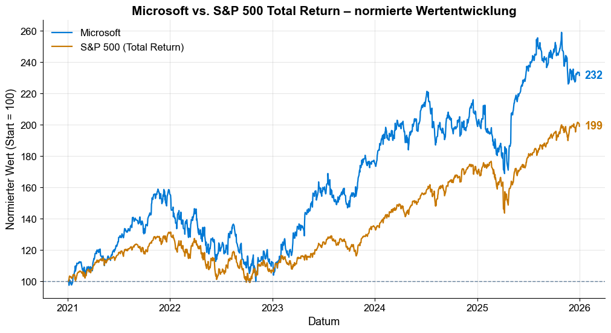

# Aktienanalyse Microsoft (MSFT) vs. S&P 500 Total Return

Rendite- und Risikoanalyse der Microsoft-Aktie für den Zeitraum 2021–2025 mit Python – inklusive Benchmark-Vergleich mit dem S&P 500 Total Return Index.

Projekt im Rahmen der Weiterbildung **„Python und Data Science im Finanzwesen“** an der IU Internationale Hochschule (Kurs: Projekt Programmierung mit Python, Stand 10/2026).

## Leitfrage

Welche Rendite erzielte Microsoft, welches Risiko war damit verbunden und wie ist das Ergebnis gegenüber dem Markt einzuordnen?

## Ergebnisse

| Kennzahl | Microsoft | S&P 500 TR |
|---|---:|---:|
| CAGR (geometrische Jahresrendite) | 18,38 % | 14,84 % |
| Annualisierte durchschnittliche Rendite | 20,17 % | 15,28 % |
| Annualisierte Volatilität | 25,71 % | 16,96 % |
| Maximum Drawdown | −37,15 % | −24,49 % |
| Value at Risk (95 %, 1 Tag) | −2,64 % | −1,64 % |
| Sharpe Ratio (rf = ^IRX, Ø 3,22 %) | 0,66 | 0,71 |
| Sharpe Ratio (rf = 0 %, Robustheitsprüfung) | 0,78 | 0,90 |
| Sortino Ratio (rf = ^IRX) | 0,97 | 1,02 |

- Datenbasis: **1.255 gemeinsame Handelstage** (04.01.2021–31.12.2025), keine fehlenden Werte
- Wertzuwachs des bereinigten Kurses: **+131,53 %**
- Korrelation der Tagesrenditen mit dem Markt: **0,76** · Beta: **1,15** (rollierend zwischen 0,91 und 1,40)
- Vorsprung von Microsoft vor allem 2021 und 2023; in drei von fünf Kalenderjahren lag der Index vorn



**Fazit:** Microsoft erzielte die höhere Rendite, der S&P 500 TR das bessere Verhältnis von Rendite zu Risiko – nach Sharpe und Sortino, mit und ohne risikofreien Zinssatz.

## Vorgehen

1. **Daten beschaffen** – Yahoo Finance über `yfinance` (bereinigte Kurse; `^SP500TR` als Benchmark, `^IRX` als risikofreier Zinssatz)
2. **Qualität prüfen** – Zeitraum, Datentypen, fehlende Werte, Abgleich der Handelstage und Zeitzonen
3. **Kennzahlen berechnen** – Tages-, kumulative und geometrische Rendite (CAGR), Verteilung (Schiefe, Kurtosis, Jarque-Bera), Volatilität (gesamt und rollierend 30 Tage), Maximum Drawdown, VaR und CVaR, Sharpe und Sortino Ratio, Korrelation, Beta (gesamt und rollierend)
4. **Visualisieren und einordnen** – Kursverlauf mit SMA 50/200, Drawdown, Volatilität, normierte Wertentwicklung, Risiko-Rendite-Diagramm, Kalenderjahresvergleich

## Grenzen

Historische Kennzahlen sind keine Prognose. Die Analyse nutzt eine Datenquelle (Yahoo Finance); beim erneuten Abruf können sich einzelne Werte durch Datenkorrekturen leicht verändern. Steuern, Transaktionskosten und Wechselkurseffekte für Euro-Anleger werden nicht berücksichtigt.

## Dateien

| Datei | Inhalt |
|---|---|
| `Microsoft_Aktienanalyse.ipynb` | Jupyter Notebook mit Code, Ausgaben und Grafiken |
| `Praesentation_Microsoft_Aktienanalyse.pdf` | Projektpräsentation (16 Folien) |
| `wertentwicklung.png` | Grafik: normierte Wertentwicklung (aus dem Notebook) |
| `requirements.txt` | Benötigte Python-Pakete |

## Ausführen

```bash
pip install -r requirements.txt
jupyter notebook Microsoft_Aktienanalyse.ipynb
```

## Werkzeuge

Python · pandas · NumPy · SciPy · Matplotlib · yfinance · Jupyter

---

**Ashraf Al Keilani** · Hannover · [LinkedIn](https://www.linkedin.com/in/ashraf-al-keilani)
